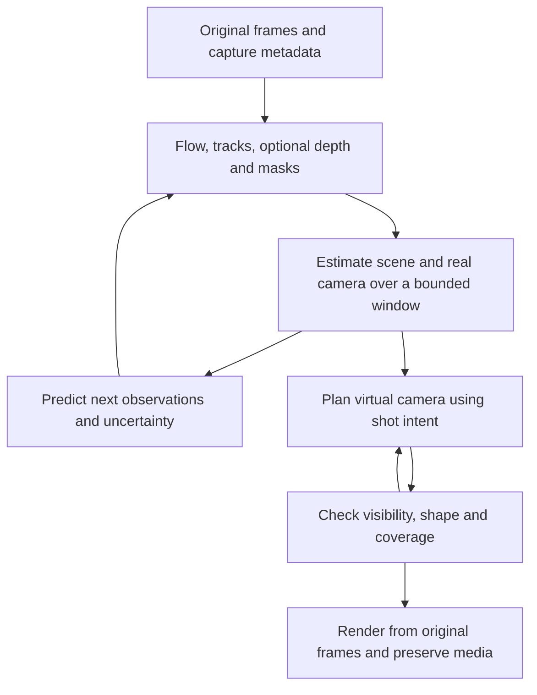

# Video stabilization development plan

Build an Apple Silicon stabilizer that preserves scene structure and intended camera movement, uses compute efficiently, and behaves reliably on long videos. Tie depth, motion, prediction, multiscale analysis, and subject tracking together through a shared estimate of the scene and camera. Introduce each capability through an experiment with a measurable benefit and a defined fallback.

This plan covers the Python and MLX reference implementation, a conditional Rust production runtime, evaluation, and release decisions. It is based on repository commit 67942cfa90b5da763c6978bc1e13212b8d923d68, inspected on October 14, 2026. Proposed improvements and targets below are not measured results.

## Scope and working decisions

The initial product is offline stabilization on Apple Silicon, with bounded memory and full resolution output. Use future observations within an analysis window when available. A later online mode must have its own quality and latency contract. Full resolution output does not require running every model at full resolution.

The immediate development machine is an Apple M5 with 24 GiB of unified memory. Validate other memory sizes and chips on actual hardware before claiming support or performance. Keep portable reference code, but do not promise superiority over PyTorch on every device, training workload, or model.

Make two distinct comparisons:

1. **Backend comparison:** the same RAFT weights, inputs, precision, iteration count, and outputs using MLX and optimized PyTorch MPS. This measures implementation efficiency.
2. **Stabilizer comparison:** complete outputs at matched quality, crop, border policy, and media settings. Compare the current stabilizer, proposed variants, and a conventional baseline. A PyTorch flow adapter inside the same pipeline isolates the backend contribution; an independently implemented full PyTorch pipeline is required for broader claims about complete implementations.

The upstream PyTorch RAFT repository supplies optical flow, not an equivalent complete stabilization product. Depth, better planning, and prediction can also benefit a PyTorch implementation. Attribute gains to their actual causes.

Prefer Python for research and evaluation, MLX for tensor computation, and Metal for justified custom kernels. Rust is the preferred candidate for a reusable production core, conditional on a compatibility spike. Keep the model and numerical algorithm fixed during language comparisons. Swift remains an optional future application frontend.

## Starting evidence

[STATUS.md](STATUS.md) contains historical measurements, rather than a current release benchmark:

- At 960 × 544 and 12 iterations, bidirectional fp32 RAFT took 0.67 seconds in MLX and 0.80 seconds in PyTorch MPS. These are modest backend gains.
- The saved synthetic pipeline benchmark rose from 0.41 to 1.05 frames per second through engineering changes, then to 1.97 with fp16 and fewer warm iterations. Real footage quality gates for the fast variants remain incomplete.
- An analysis stride of two reached 3.57 frames per second but lost much of the synthetic jitter reduction. Keep frame skipping opt-in until it passes new tests.
- Clip B lacks a rerun with the current fidelity setting. Reported tree deformation and floaty movement need reproduction and diagnosis.
- Feature reuse, bidirectional batching, a compiled update, a custom correlation lookup, one final upsampling-mask calculation, decoder and encoder threads, CPU fitting overlap, and faster RANSAC already exist. New work must build on them.
- Existing checks establish useful numerical parity. They do not establish perceptual quality, full media preservation, or production reliability.

This plan was written before several evaluation fixes landed. The evaluator now resets all flow and feature state at clip boundaries, mask exclusion checks the correspondence destination, and opt-in diagnostics measure the complete rendered warp; combined fp16 network/correlation coverage is also tested. See the dated evidence in [STATUS.md](STATUS.md). Stage 0 remains open because long-window configuration comparisons, the reported tree-deformation/floaty-motion reproduction, and the real-window motion-field audit are unfinished.

## Architecture

Maintain separate estimates for the camera that recorded the scene and the virtual camera that should produce the stabilized shot. A smooth virtual path should not bias the estimated physical camera toward a false smooth trajectory.

The feedback from prediction requests additional observations or refinement. The feedback from rendering constraints limits the virtual camera to an achievable view. Neither loop should hide an invalid estimate by repeatedly deforming the image.

| Shared record | Required information | Purpose |
| --- | --- | --- |
| Capture | Presentation timestamps, exposure if known, dimensions, orientation, color metadata, intrinsics, lens model, field order and row timing where available | Describe how observations were formed |
| Observations | Flow, feature identity, residuals, masks, image quality, visibility and model provenance | Preserve evidence without prematurely classifying its cause |
| Scene and camera | Real camera state, depth in a consistent scale, region tracks, independent motion hypotheses and separate uncertainty estimates | Explain observations over time |
| Intent | Lock-off, pan, follow-subject or preserved handheld character; subject and framing constraints | Define what the output should retain |
| Virtual camera | Desired path, crop or border policy, correction strength, visibility and shape constraints | Select an achievable stabilized view |
| Render provenance | Source frame and coordinates, valid coverage, temporal fill and generated-content flags | Make missing information and output construction explicit |

Use explicit coordinate conventions: source and destination frame IDs, pixel-center convention, forward and inverse warp direction, camera-to-world versus world-to-camera poses, and units. Track timestamps in a rational time base. Express derivatives using elapsed time rather than frame number.

Begin with image-space motion and a depth-guided mesh. Introduce full 3D pose and reprojection only if the simpler representation fails a demonstrated quality need. For 3D, depth and translation must share a consistent scale; arbitrary per-frame depth normalization is insufficient. Absolute distances in meters are optional when a common arbitrary scale is adequate.

Preserve original observations throughout optimization. Compose the final correction and sample original imagery once. Temporal completion may use neighboring original frames with visibility checks, rather than repeatedly sampling previously stabilized outputs.

## Evaluation contract

### Corpus and baselines

Start with approximately 24 to 40 short clips spanning static scenes, deliberate pans, walking, near and far parallax, moving foregrounds, faces, thin straight structures, vegetation, low texture, low light, blur, zoom, rolling shutter, occlusion and shot cuts. Include existing private camcorder windows locally; keep private footage out of public artifacts. Add long clips for memory growth and chunk seams.

Create physically grounded synthetic sequences with known camera poses, depth, independently moving objects, occlusion, exposure integration and row timing. Retain simpler existing synthetic tests for fast iteration. Include both fractal and non-fractal motion; a fractal generator alone would favor the proposed prior by construction.

Split by source video or scene into development, calibration and held-out evaluation sets. Neighboring windows from the same source must not cross those boundaries. Select models, thresholds and presets before opening the held-out results. Expand the set when confidence intervals or scene coverage are inadequate.

Every experiment must specify its baseline, changed variable, hypothesis, expected benefit, primary metric, regression limits and stopping rule. Store a manifest with source hashes, frame timestamps, code commit, dependency and weight versions, seed, hardware, configuration and licenses. Cache keys must include preprocessing, model, resolution, dtype and temporal state dependencies. Clear sequence state at boundaries.

Use paired clip comparisons and confidence intervals resampled by clip, not by treating adjacent frames as independent samples. Review blinded videos in random order at native playback speed, with synchronized crops and diagnostic overlays available separately. Record preferences, ties and concrete artifacts.

### Measurements

| Dimension | Measurements and safeguards |
| --- | --- |
| Stability | Absolute residual jitter in pixels normalized to 1080-pixel image height, angular jitter, frequency bands and scene-specific path error; retain spectral scores as supplementary metrics |
| Shape | Jacobian singular values, determinant or triangle orientation, stretch and shear distributions for the complete global plus mesh plus row warp; straight-line bending and temporal variation |
| Intent | Pan lag, overshoot, retained path shape, subject framing and unwanted movement of static shots |
| Coverage | Mean, upper percentile and worst missing area; actual crop and zoom; invalid correspondence rate and visibility at depth boundaries |
| Fidelity | Detail loss from resampling, face or object deformation, ghosting, temporal flicker and blur mismatch |
| Geometry | Pose and depth consistency where truth exists; reprojection on tracks excluded from fitting; calibration and failure detection |
| Runtime | Cold startup, model loading, warm inference, analysis time, rendering time, encoding time, total wall time and latency distribution |
| Resources | Peak process memory, MLX active and cached memory, memory pressure and swap; energy per output frame when measurable with a documented method |
| Reliability | Cancellation, resume, corrupt inputs, encoder failure, cuts, variable frame rate, long-video memory and audio synchronization |

Use independent tracks or another estimator for at least part of evaluation. Reusing the stabilizer's own RAFT estimator as the sole judge can reward its errors. Failed motion fits must count as failures, rather than identity transforms that appear perfectly stable. Compare on common valid image support and report its area; masks must not conceal difficult regions.

Run timings sequentially without competing GPU benchmarks, and distinguish warm caches from a complete fresh run. Begin with at least five repeated timing runs and extend when variation affects the decision. Record thermal and power conditions. Include the cost of generating depth and masks in end-to-end results even when cached observations were used during algorithm development.

### Proposed acceptance thresholds

Use a baseline-only pilot to measure noise and freeze thresholds before comparing candidates. The following are initial engineering targets, subject to that calibration:

- Preserve the existing fp32 RAFT parity gate of mean endpoint error below 0.01 pixel on reference fixtures; add tail-error checks and difficult scenes. Approximations require separate quality gates.
- Accept a speed-only change if held-out quality is non-inferior: initially no scene-stratum jitter increase beyond the larger of 5 percent or 0.1 normalized pixel, no new severe artifacts, and unchanged crop and coverage limits. Use the absolute bound near zero.
- Seek at least a 10 percent end-to-end speed improvement for a new optimization that adds meaningful complexity. A component may instead qualify by making a previously impossible memory budget feasible or materially improving reliability.
- Seek at least a 20 percent improvement in the targeted defect, such as parallax wobble, with no material regression elsewhere. Visual review must agree that the numerical gain is useful.
- Permit no unintended foldovers inside a continuous rendered surface. Treat intentional depth discontinuities separately; do not smooth a Jacobian across unrelated surfaces. Border and crop limits must hold for the complete rendered mapping.
- Static inputs should remain unchanged within the calibrated noise and resampling tolerance. A method that manufactures movement fails regardless of average scores elsewhere.
- For a calibrated uncertainty model, test nominal interval coverage on held-out data and stratify errors by confidence. As an initial target, a nominal 90 percent interval should achieve coverage within five percentage points when sample size supports that estimate.
- Aim for a 2× complete-pipeline speedup over the matched-quality optimized PyTorch comparison on the target Mac. This is a stretch goal, not a prerequisite for shipping a valuable quality improvement and not a current claim.

Report tradeoffs as quality-versus-time and quality-versus-memory curves. Keep separate presets when one configuration does not dominate. Define a memory ceiling with operating-system headroom from the baseline pilot, then test that ceiling rather than treating all 24 GiB as available model memory.

## Implementation stages

### Stage 0 Establish trustworthy measurements

The evaluator reset, target-mask sampling, and source-versus-destination mask counterexamples are implemented. Preserve these lifecycle and coordinate contracts when adding new sequence boundaries or evaluators.

Complete-warp diagnostics, a local-field regression case, and combined fp16 network/fp16 correlation coverage are implemented. The diagnostics remain opt-in because their measured cost is substantial.

Remaining work: run matched 10-second/full-window configuration comparisons, reproduce the reported tree deformation and floaty motion with global-only, mesh-only, row-only and combined ablations, and audit motion-field accumulation under rotation and parallax on real windows. Treat fixed-grid residual accumulation as a hypothesis until a counterexample establishes an error. The matched one- and two-second ablations and real-footage baselines are recorded in [STATUS.md](STATUS.md); they do not close these remaining checks.

**Exit:** a repeatable baseline report, independently checked metrics, meaningful failure counts and minimal regression fixtures. No new quality claim advances before this gate.

The localized-support map candidate has now been rendered on three 10-second windows and the fixed eight-stream backend panel. It reduced geometric invalid support throughout, but motion results were mixed, the reference 5% jitter margin was not met, KLT coverage was incomplete, and position-reversed Gemini reviews were inconclusive. Keep this candidate research-only and do not integrate it. A minimal-support crop screen on one development window restored full Lanczos-3 support at zoom 1.088 with mixed estimator results and about 15.5% frame-area loss; that tuned-window result does not establish a policy. The existing same-coordinate temporal-fill pilot recovered 36% of invalid pixels at radius 3 on that window, with an inconclusive reversed Gemini pair. An optional bilateral RGB agreement gate filled only 0.010–0.040% of invalid pixels at tested thresholds 16–64, so it is too conservative to be useful as configured. Keep both experiments diagnostic. Temporal donor alignment should run only where a neighboring original frame supplies a visibility-supported correspondence; a border mask alone does not identify missing scene content, and never-visible disocclusions remain unfilled. If adaptive cropping is revisited, declare a crop-area cap and separate development from held-out data first; evaluate support, motion, shape and visible artifacts separately. See `STATUS.md`.

### Stage 1 Stabilize interfaces and the geometric baseline

Separate observation extraction, real-motion estimation, virtual-path planning and rendering while preserving current behavior through parity fixtures. Add timestamped records, explicit transform conventions, reset semantics and versioned analysis caches. Avoid a broad framework rewrite.

Compare the current mesh regularization with shape-preserving local transforms, robust line constraints and constrained mesh optimization. Protect rigid structures while allowing discontinuities between surfaces. Make rolling-shutter correction conditional on evidence; an unconstrained row warp can explain parallax or object motion incorrectly.

Validate smoothing across chunk boundaries and variable frame intervals. Replace component-wise border heuristics with checks of the actual composed warp and sampler footprint. Distinguish truly absent source pixels from interpolation taps that extend beyond the image.

**Exit:** a dependable 2D baseline that preserves straight structures, has stable seams and obeys coverage constraints. If additional flexibility produces wobble, retain the simpler fit until evidence supports it.

### Stage 2 Prediction and adaptive computation

Predict short-term real camera motion using constant velocity, then compare constant acceleration. Derive expected stationary-scene image motion from geometry when available. Properly transport previous flow estimates into the next pair's coordinates; do not assume an old flow array is already a valid new initialization. Handle the backward direction explicitly.

Use prediction to initialize inference and allocate refinement, with a cheap observation on every frame. Compare fixed iteration counts with confidence-controlled stopping and additional iterations after a surprise. Bound retries. Occlusion, absent texture and severe blur may need a fallback rather than additional compute.

Maintain separate uncertainty for correspondence, depth, camera fit, visibility and prediction. Calibrate it using withheld observations and synthetic truth. Depth and flow inferred from the same pixels have correlated errors; agreement is not independent confirmation.

Offline mode should correct recent history using actual future frames. Test zero, short and longer lookahead windows separately. Learned prediction is a later candidate only if simple models leave a measurable gap.

**Exit:** fewer total operations at matched output quality, with no added overshoot or delayed recovery after jolts and cuts. Otherwise use prediction only as a warm start and keep fixed reliable refinement.

### Stage 3 Depth and persistent scene support

First test cached depth from an existing reference model. This establishes whether geometry improves stabilization before investing in an MLX port. Compare no depth, per-frame relative depth, temporally consistent video depth, and oracle depth on synthetic scenes. Oracle depth separates a weak geometric method from a weak depth estimator.

Start with depth-aware fit weights and a mesh that respects depth boundaries. Use depth for grouping, not as unquestioned geometry. Test the cost and reliability of keyframe inference with temporal propagation and confidence-triggered refresh.

[Video Depth Anything Small](https://github.com/DepthAnything/Video-Depth-Anything) is an initial video-depth candidate. Its repository distinguishes Apache-2.0 Small weights from noncommercial Base and Large weights; verify the exact chosen artifact before packaging. Its streaming mode is experimental and must be evaluated separately. [Depth Anything 3](https://github.com/ByteDance-Seed/Depth-Anything-3) is a candidate for joint geometry experiments, and [Depth Pro](https://github.com/apple-aiml-research/ml-depth-pro) provides a possible single-image metric-depth and focal-length baseline. None is presumed fast or accurate enough on this Mac without measurement.

Build persistent region and feature tracks. Iteratively estimate camera motion from plausible stationary support, then reclassify residual motion using depth, visibility and history. A residual may indicate object motion, bad depth, occlusion or blur. A semantic label alone cannot determine whether a region is moving.

Use a user selection or detector to initialize optional subject masks. [SAM 2](https://github.com/facebookresearch/sam2) is a candidate for promptable video segmentation and tracking; semantic classification and shot intent require additional logic. Compare simple tracked masks before adding a large segmenter. Keep subject protection separate from deciding which regions support camera estimation.

**Exit:** less parallax-induced wobble and subject deformation with reliable fallback under bad depth, reflections, foliage and dominant moving foregrounds. If depth adds little, retain the geometric baseline and optional subject masks.

### Stage 4 Multiscale motion and fractality

Start with multiscale temporal decomposition of estimated camera motion, using elapsed time and separating intentional motion from residual jitter. Compare the existing L1 path planner, a fixed multiscale planner, and an adaptive multiscale planner at matched crop and delay.

Only then test a fractal prior: estimate whether a stable scaling relationship exists over enough temporal scales, and whether a Hurst or fractional-process parameter improves held-out prediction, uncertainty or smoothing weights. Use confidence intervals, shuffled controls and non-fractal motion. Short windows, pans, periodic walking and abrupt shocks can give misleading scaling estimates. [Wavelet analysis of long-range dependence](https://perso.ens-lyon.fr/patrice.abry/ARTICLES_PDF/AbryVeitch98.pdf) supplies a measurement approach; it does not establish that camera shake follows that model.

Separately test spatially adaptive meshes driven by depth boundaries, motion residuals and confidence. A recursive grid is not by itself evidence of fractality. Use bounded tile sizes or mesh templates when they improve batching. An adaptive render mesh does not reduce dense RAFT computation unless the flow algorithm itself changes.

**Exit:** keep multiscale processing if it improves the output. Keep a fractal prior only if it adds value over the best non-fractal multiscale baseline. Drop it without blocking the rest of the architecture if the hypothesis fails.

### Stage 5 Joint geometry and shot planning

If Stage 3 demonstrates a need for 3D, optimize a bounded window of camera poses, depth scale and persistent tracks together. Anchor the coordinate system and scale, use robust losses, and exclude or separately model independently moving regions. Preserve a 2D or rotation-only fallback for weak geometry, including pure rotation and inadequate parallax.

Add intrinsics and lens-distortion handling before interpreting flow as physical motion. Treat focal changes and zoom explicitly. Incorporate rolling-shutter readout and exposure when known, estimating unknown values only when the observations constrain them. Optional synchronized gyro data is another measurement source with its own calibration and uncertainty.

Plan the virtual camera with an objective that balances temporal smoothness, intended movement, subject framing, shape preservation, coverage and uncertainty. Apply hard geometric and coverage constraints separately from weighted preferences. Evaluate lock-off, deliberate pan, follow-subject and retained handheld modes first through explicit user selection. Automatic suggestions may follow, with conservative confidence and an override.

Forward projection and visibility reasoning must expose disocclusions. A planner should reduce an infeasible correction rather than bend a foreground object to hide a hole. Model exposure-related blur separately: changing the camera path does not undo blur already integrated during capture. Test blur-aware correction limits before introducing deblurring.

**Exit:** a scene-aware planner that beats the best 2D version on its target scenes at an acceptable compute cost. If it does not, ship depth-guided 2D stabilization and reserve 3D for an optional mode.

### Stage 6 Memory scaling and model efficiency

Profile the accepted pipeline again; earlier profiles identified convolutions as the largest RAFT cost. Optimize measured bottlenecks, including additional depth or segmentation costs, instead of assuming Python dispatch dominates.

For a dense four-level RAFT correlation pyramid with separately stored forward and backward directions, storage grows approximately quadratically in feature-map area. Calculated correlation-only storage is about 11.3 GB in fp32 at 1920 × 1088, and 178 GB at 3840 × 2160; fp16 halves those amounts. These decimal-GB estimates exclude features, activations and allocator overhead. Full-resolution 4K dense correlation is therefore outside this machine's budget.

Compare reduced-resolution flow with full-resolution rendering, on-demand correlation, tiled or local correlation with a coarse global search, and precision variants. [Upstream RAFT](https://github.com/princeton-vl/RAFT) offers an alternate correlation approach that saves memory at a speed cost; lower memory must not be advertised as automatic acceleration. Check large displacements, seams and occlusion for localized variants. Sharing forward and backward correlation storage requires correct handling of the differently pooled axes.

Retain the existing MLX graph and custom Metal paths when they win. Change tensor layouts, convolution strategies or fusion only after profiling, including compile and specialization overhead. Measure depth refresh, mask refresh and flow refinement under one resource budget without starving the evidence needed for quality.

An opt-in correlation-payload estimator and `flow_downscale=auto` resolver are implemented. The explicit budget covers stored forward/backward RAFT correlation pyramids only, not total or peak process memory; defaults remain unchanged. A three-frame synthetic 4K smoke confirms execution at scale 4, but not production memory safety or quality. On two matched one-second windows from 1080i `00176.MTS`, scale 4 ran about 2.5x faster than scale 2 but produced consistently higher RAFT jitter/wobble, independent KLT jitter, and border loss; Gemini's position-reversed review was inconclusive. A follow-up ten-second window on distinct 1080i source `00177.MTS` confirmed a larger quality regression: scale 4 was 2.52x faster, but its fixed scale-2 evaluator measured 5.72x the scale-2 jitter. Replayed one-second blocks were worse at scale 4 in every block, with no fit fallbacks to explain the difference; Gemini's blinded review was inconclusive. A scale-4-only diagnostic replay found low robust-fit inlier fractions during the two worst seconds, while the two `00176` windows had high inlier fractions and much smaller scale-4 penalties. A 48-cell controlled synthetic flow screen then found scale 4 had higher known-translation EPE in every condition, but its fit-inlier p10 stayed at 1.0 throughout. Drop this statistic as a scale-selection gate candidate; it is neither varying nor calibrated on these controls. Full-resolution scale 1 did not complete a one-second window within 10m48s on this machine. Keep automatic selection opt-in and do not claim scale-4 quality parity or a production 4K preset. Initial full-stabilization path audits on one far-only synthetic scene found scale 4 worse at high frequency than scale 2 while both runs showed large low-frequency path drift. An exact-motion planner audit then reproduced linear-pan suppression with production L1 smoothing (`fidelity=0.1`), while a five-seed fidelity sweep showed a potential retention/jitter tradeoff near fidelity 3. One matched RAFT-rendered far-only control at fidelity 3 reduced path RMSE from 18.06 to 3.93 px while evaluator jitter rose from 0.029 to 0.198 px; Gemini's review was inconclusive because the synthetic texture had no recognizable structure. Keep the default unchanged until more rendered profiles and a natural clip validate the tradeoff. See `STATUS.md` for measured panels and limitations.

If RAFT remains the limiting factor, compare a smaller flow model or distillation against the accepted teacher and downstream stabilization quality. A shared flow, depth and motion encoder is a later research option; it introduces training and correlated-error risks. Do not add backward kernels or a training pipeline until such an experiment has a concrete objective and data plan.

**Exit:** 1080p and 4K-output presets that stay within measured memory limits and offer documented quality and time tradeoffs. Real-time capability requires sustained end-to-end throughput and latency measurements, not isolated model timings.

### Stage 7 Rendering and production reliability

Make crop, preserve-canvas with missing-pixel masks, and conservative temporal completion explicit policies. Test temporal fill from visible neighboring surfaces before learned inpainting. Require temporal and photometric consistency to prevent ghosts. Keep generated fill optional, with provenance, and measure its separate cost and artifact rate.

Preserve presentation timestamps, duration, orientation and intended color interpretation. Add explicit audio remuxing or resynchronization rules when the video timeline changes. Handle interlaced fields with their actual temporal order. Support higher bit depth and HDR through a verified color path, or reject unsupported preservation requests clearly rather than silently converting them to 8-bit SDR. Decide subtitle and metadata preservation explicitly.

Provide bounded queues, memory accounting, cancellation, resumable analysis, atomic output completion and errors that propagate across decode, analysis and encode workers. Exercise disk-full, broken encoder, malformed frames, interrupted jobs and incompatible caches. A long run must have bounded memory and no hidden worker failure.

Package a documented CLI and Python API, optional native library, reproducible model conversion, weight hashes, model provenance and dependency notices. Verify installation away from the development checkout and packaged Metal-library discovery. Add platform-appropriate CI with lightweight CPU checks plus a distinct Apple GPU validation job; report skipped model tests explicitly.

**Exit:** a release candidate with repeatable quality results, usable media outputs, reliable failure handling and installation instructions validated on a clean environment.

## Rust compatibility and migration decision

Run this investigation after Stage 0 produces fixtures and Stage 1 establishes interfaces. It may proceed independently of depth and fractal experiments; a language migration must not block algorithm validation.

The proposed production division is Rust for state, scheduling, caches, CLI and library boundaries; MLX for model execution; Metal for specialized kernels; and Python for the reference implementation, experiments and evaluation. Retain efficient native numerical libraries behind the appropriate boundary instead of rewriting working solvers by default.

The initial spike must load existing safetensors, run the same bidirectional RAFT model and compiled updates, reproduce custom correlation lookup and sampling, and match Python MLX intermediate and final outputs. Test both dtype paths, noncontiguous arrays, odd dimensions, repeated model construction, cancellation and error recovery. Measure end-to-end time, copies, synchronization and memory over repeated calls.

[mlx-rs](https://github.com/oxiglade/mlx-rs) is a community binding. Its [0.32.0 changelog](https://github.com/oxiglade/mlx-rs/blob/main/mlx-rs/CHANGELOG.md) targets MLX 0.32.2 and marks compiled functions as not Send. Pin a tested Rust, MLX C API and MLX version combination; the currently installed Python environment need not match it. Construct and use compiled models on an owning worker thread, with messages across threads. Do not force shared compiled state through unsafe thread declarations. [mlx-c](https://github.com/ml-explore/mlx-c) is an alternative bridge when a narrowly scoped binding gap can be addressed sustainably.

| Decision | Pass condition | Failure action |
| --- | --- | --- |
| Adopt Rust for production orchestration | Numerical parity, safe ownership, bounded memory, manageable dependencies and maintenance; no more than the calibrated runtime regression budget | Keep Python orchestration and revisit only a demonstrated bottleneck |
| Move geometry and planning to Rust | Fixtures remain equivalent and profiling or deployment needs justify the work | Retain the reference solver or a narrow library boundary |
| Use native Apple decoding and encoding | Verified timestamp, color and audio behavior with a measurable performance or integration benefit | Keep FFmpeg as the baseline implementation |
| Claim reduced copies | Trace actual buffer ownership, format conversions and synchronization across decoder, MLX, renderer and encoder | Describe the measured copies; do not call unified memory zero-copy |
| Ship a standalone executable | Models, native dependencies and Metal libraries resolve outside the checkout | Ship a documented package until deployment is reproducible |

Use bindings to [VideoToolbox](https://docs.rs/objc2-video-toolbox/latest/objc2_video_toolbox/) and [AVFoundation](https://docs.rs/objc2-av-foundation/latest/objc2_av_foundation/) as integration candidates, not proof of a zero-copy path. Rust does not inherently speed up GPU convolutions. Do not simultaneously switch to a new tensor framework or retrain the model during this migration.

## Experiment register

Each row becomes a reproducible configuration and result record. A failed experiment should record the failure and retain the simpler working baseline.

| ID | Question and comparison | Decision criterion |
| --- | --- | --- |
| E01 | Do repaired masks, resets and full-warp metrics change conclusions? Compare old reports with corrected evaluation on controlled counterexamples and real clips. | Correct the baseline before ranking methods. |
| E02 | What causes deformation? Global, mesh, rows and their combinations, including transported residual composition. | Keep only flexibility that improves motion without bending rigid structures. |
| E03 | Which precision is safe? fp32 versus fp16 network, fp16 correlation, and both. | Backend parity plus downstream quality; report all precision settings. |
| E04 | Does prediction save useful work? Cold initialization, transported flow, constant velocity and constant acceleration. | Lower complete analysis time without shock overshoot or slower recovery. |
| E05 | Can refinement be adaptive? Fixed iterations versus calibrated stopping and capped retries. | Matched quality with lower mean cost and bounded tail latency. |
| E06 | How much lookahead is useful? Past-only, short lookahead and a longer offline window. | Select separate offline and online quality-latency operating points. |
| E07 | Does depth help the warp? No depth, predicted image depth, video depth and oracle depth. | Reduce parallax defects; diagnose predictor versus geometry failures. |
| E08 | How often is depth needed? Every frame, fixed keyframes and adaptive refresh. | Keep temporal consistency while reducing total depth cost. |
| E09 | How much scene understanding is useful? Robust motion only, persistent regions, user masks and optional semantic masks. | Improve camera estimation or subject protection beyond inference overhead. |
| E10 | Does multiscale planning help? L1 baseline versus fixed and adaptive scale weights. | Reduce jitter while preserving deliberate paths at equal crop and delay. |
| E11 | Does a fractal prior add anything? Best multiscale method versus scaling-based weights or prediction, with shuffled and non-fractal controls. | Keep only if held-out gains exceed uncertainty and generalize. |
| E12 | Does spatial adaptivity help? Fixed mesh versus depth and residual-guided refinement. | Better shape or lower fitting/render cost, without seams. |
| E13 | Is 3D justified? Best depth-guided 2D method versus joint camera/depth optimization and reprojection. | Meaningful quality gain and reliable degenerate-case fallback. |
| E14 | When should rolling-shutter correction run? Off, current row model, evidence-gated row model and physical readout model. | Improve known rolling shutter without distorting global-shutter controls. |
| E15 | Can intent be inferred safely? Explicit modes versus automatic mode suggestions and confidence thresholds. | Preserve pan and framing; uncertain cases retain user choice. |
| E16 | Which correlation strategy scales? Dense, on-demand, lower-resolution and coarse-to-local or tiled variants. | Satisfy memory budget and quality; compare time separately. |
| E17 | Is a new model worthwhile? Accepted RAFT versus smaller flow model or distilled model at matched output quality. | Material complete-pipeline gain after accounting for conversion and training burden. |
| E18 | Is uncertainty useful? Unweighted fits, heuristic weights and calibrated uncertainty; inject bad depth, missing tracks and blur. | Better error detection and fallback, not just higher confidence scores. |
| E19 | How should borders be handled? Matched crop, preserved canvas, temporal fill and optional learned fill. | Respect user policy with no new ghosts or unmarked generated regions. |
| E20 | Is Rust a sound runtime? Same models and algorithm through Python MLX and Rust MLX. | Parity, ownership, packaging, runtime and sustained-memory gates pass. |
| E21 | Does native media integration help? FFmpeg versus native decode/encode with identical media requirements. | Preserve timing and color while improving measured cost or deployment. |
| E22 | Do the components help together? Accepted baseline plus prediction, depth and multiscale processing separately, then pairs and combined. | Retain each component only if its marginal benefit survives integration. |
| E23 | Does blur-aware planning help? Ordinary correction, exposure-aware correction limits and an optional deblurring reference. | Less perceptual blur mismatch without inventing detail or damaging sharp controls. |
| E24 | Does the product survive real use? Long clips, cuts, variable frame rate, empty and single-frame input, cancellation, resume and injected worker failures. | Bounded resources, correct media, explicit errors and no stale-state contamination. |

For E22, use a small factorial study of prediction, depth and accepted multiscale processing. Add fractality only after E11 passes. Repeat timing with observation acquisition enabled. Cached flow and depth isolate algorithmic effects during development but cannot establish production speed. Test combined failure cases, such as bad depth during a fast pan with a moving foreground, as well as isolated defects.

## Dependencies and decision points

The critical path is Stage 0 measurements, Stage 1 dependable geometry, accepted observation and planning improvements, then integrated validation and Stage 7 release work. Prediction and multiscale experiments can begin after Stage 1. Depth validation can begin with cached observations once the evaluation contract is ready. Full 3D depends on a positive depth result. Rust migration depends on its spike, not on a preference for the language. Memory feasibility should be checked early; fine optimization follows accepted quality changes.

| Decision | Initial position | Evidence that changes it |
| --- | --- | --- |
| Offline or online first | Offline with bounded windows | A specific interactive use case justifies a separate latency target |
| Full 3D or depth-guided 2D | Depth-guided 2D first | E13 shows a useful additional quality gain |
| Depth model | Prototype Small video depth and compare alternatives | E07 and E08 quality, memory, latency and artifact licensing |
| Meaning of content understanding | Persistent geometry, visibility, motion and subject constraints | E09 demonstrates extra value from semantic labels |
| Fractality | Optional hypothesis | E11 beats non-fractal multiscale methods |
| Learned prediction | Defer | E04 to E06 expose a gap that simple models cannot close |
| Frame skipping | Opt-in | Matched-quality evidence across motion strata, including shocks |
| Shared multitask model | Defer | Independent models dominate runtime and sufficient training data exists |
| Rust production core | Preferred conditional choice | E20 compatibility and maintenance results |
| Generative completion | Optional and separate | E19 demonstrates user-relevant improvement with explicit provenance |
| Real-time claim | Undecided | Sustained complete-pipeline throughput and latency on named hardware |

## Repository work packages

Keep the Python reference readable while adding capabilities through a small number of boundaries. The following names describe proposed additions, not existing implementations.

| Area | Existing files | Next change |
| --- | --- | --- |
| Evaluation | bench/evaluate.py, mlxstab/metrics.py, tests | Reset and mask correctness, complete-warp metrics, manifests and independent evaluation |
| State and observations | mlxstab/stabilize.py, mlxstab/motion.py | Explicit lifecycle, timestamped observations, confidence, cache interfaces and optional depth/tracking adapters |
| Geometry and planning | mlxstab/geometry.py, mlxstab/smooth.py | Shape constraints, transform composition, multiscale options, intent and bounded-window optimization |
| Models | mlxstab/raft/model.py, mlxstab/raft/convert.py | Precision fixtures, transported initialization, adaptive refinement and correlation experiments |
| Rendering | mlxstab/warp.py | Whole-warp constraints, visibility, sampler support and provenance |
| Media and API | mlxstab/media.py, mlxstab/__main__.py, pyproject.toml | Timestamps, media preservation, cancellation, cache controls and documented presets |
| Synthetic data | mlxstab/synth.py, bench/make_synth.py | Known physical geometry, image formation and counterexamples |
| Native prototype | Proposed isolated rust directory | Minimal compatibility crate; grow into core, MLX adapter and CLI only after E20 |

The first five implementation changes should be independently reviewable:

1. Repair evaluator reset and mask-coordinate handling, with counterexample tests.
2. Add complete-warp distortion and coverage measurements, precision coverage, and baseline manifests; rerun the unfinished real-footage comparisons.
3. Add timestamped state boundaries and shape-preserving geometry experiments, including cut resets and residual-composition checks.
4. Run the transported-prediction experiment and a cached-depth quality prototype as separate configurations.
5. Run the minimal Rust compatibility spike against the frozen Python fixtures; record adoption or deferral without starting a broad rewrite.

Then run multiscale and fractality experiments, advance depth and scene tracking if successful, and decide whether joint 3D warrants its cost. Production media work can advance once timestamp and ownership interfaces stabilize. Maintain one decision record per experiment with the accepted configuration, measured result, failure cases and next action.

## Release criteria

A release is ready when the selected preset passes held-out quality and reliability gates, the full media path preserves its documented properties, and every shipped model and kernel has reproducible provenance. Publish per-scene results, failures, hardware, precision, memory, latency and quality tradeoffs. Preserve the simpler baseline as a fallback.

The first release can succeed with shape-preserving 2D stabilization, prediction and a reliable runtime. Depth, 3D, fractal priors and Rust each earn inclusion through evidence. The combined system should be easier to trust because it knows which observations support its correction, when those observations fail, and how much of the requested camera move the available footage can actually support.
