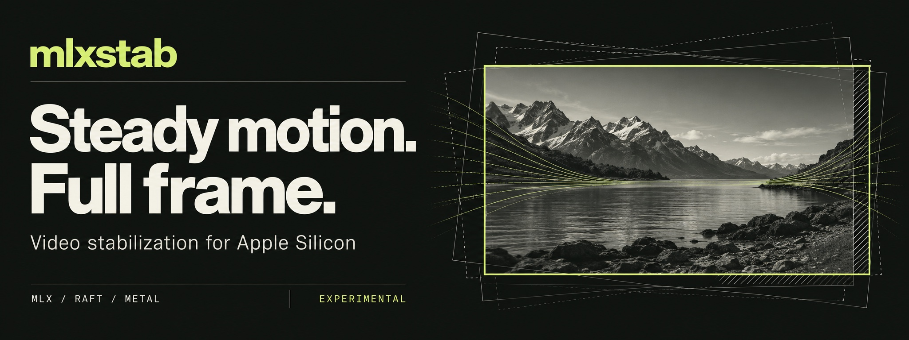
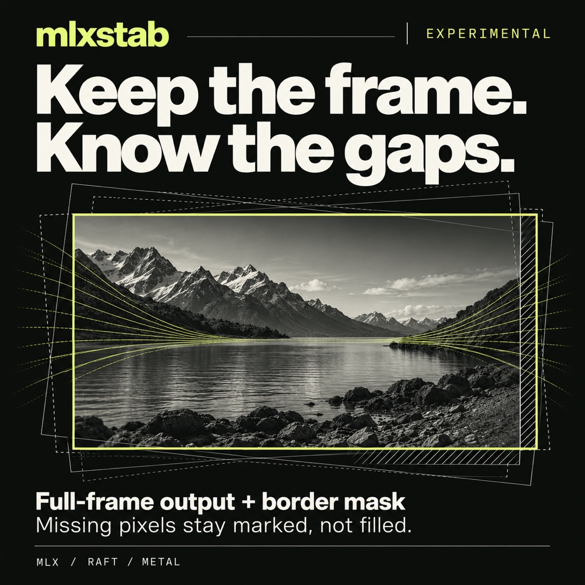

# mlxstab launch kit

Graphics and announcement copy for the experimental Apple Silicon video stabilizer in this repository. The message is **Steady motion. Full frame.** The supporting feature is full-size output with an explicit mask of missing-source pixels.

## Ready-to-use graphics

| Asset | Size | Use |
| --- | --- | --- |
| [Repository banner](assets/repo-banner.jpg) | 2048 × 768 | README header and wide editorial placements |
| [Social preview](assets/social-preview.jpg) | 1280 × 640 | GitHub social preview and landscape launch posts |
| [Square feature card](assets/launch-square.jpg) | 1080 × 1080 | Square social posts explaining border masks |

The JPEGs are ready to upload. Original generated PNGs are retained as [banner](assets/repo-banner.png), [social preview](assets/social-preview-source.png), and [square card](assets/launch-square-source.png). Their natural output sizes differ from the delivery sizes; JPEG exports preserve their aspect ratios.

The mountain scene, motion lines, and frame outlines are AI-generated conceptual artwork. They are not footage processed by mlxstab, measured optical flow, a UI screenshot, or a before-and-after demonstration.

## Copy and placement

[Launch copy](launch-copy.md) contains a GitHub description, topics, short pitch, X/Bluesky post, LinkedIn post, and a technical community announcement. Pair the short launch post with the landscape preview; pair the feature post with the square card.

The main README already uses the banner. To use the landscape asset as the repository social preview, upload `assets/social-preview.jpg` through the repository's social-preview settings. Metadata and posts in this kit are drafts for publication when the repository is ready to share.

Suggested alt text:

- **Banner or social preview:** “mlxstab: Steady motion. Full frame. Experimental video stabilization for Apple Silicon. A monochrome mountain lake sits within lime and gray frame outlines illustrating camera motion.”
- **Square:** “mlxstab: Keep the frame. Know the gaps. Full-frame output plus border mask. A hatched edge illustrates missing source coverage; the caption explains that missing pixels are marked, not filled.”

## Visual direction

| Element | Direction |
| --- | --- |
| Product name | `mlxstab`, always lowercase; repository name remains `mlx-video-stab` |
| Background | Warm charcoal, approximately `#101310` |
| Primary type | Soft ivory, approximately `#F0F0E8` |
| Accent | Chartreuse, approximately `#D6F57B`, for the wordmark and stable frame |
| Typography | Bold grotesk headlines; monospaced technical labels |
| Motif | Offset camera frames settle around a single stable frame; hatching indicates missing coverage |
| Status | Keep “EXPERIMENTAL” visible in standalone graphics |

For future layouts, use generous margins and preserve the image's proportions. Use the square version for square placements rather than cropping the landscape card. Keep copy concrete: camera motion, original frame dimensions, border masks, optical flow, and Apple Silicon.

## Claim reference

These statements describe the current implementation. Historical performance numbers are deliberately absent from the launch copy because the evaluation and real-footage quality gates remain unfinished.

| Message | Implementation or evidence | Scope |
| --- | --- | --- |
| Video stabilization for Apple Silicon | [Project metadata](../pyproject.toml), [RAFT model](../mlxstab/raft/model.py), [Metal sampler](../mlxstab/warp.py) | Experimental offline Python CLI; no desktop application is included |
| Full-frame output, no crop-in by default | [`Config.zoom` and rendering](../mlxstab/stabilize.py) | Original output dimensions; `zoom=1.0` by default. This does not mean every output pixel has source coverage or every original scene pixel remains visible |
| Explicit border mask | [`render_frame` and mask encoding](../mlxstab/stabilize.py), [CLI `--mask`](../mlxstab/__main__.py) | Opt-in mask video; white means no source. Missing borders are not filled |
| L1 camera paths with a border budget | [Path solver](../mlxstab/smooth.py), [configuration](../mlxstab/stabilize.py) | A path-deviation constraint, not a guarantee that the missing border stays below a particular pixel percentage |
| One final resample | [Composed rendering transform](../mlxstab/stabilize.py) | Original imagery is sampled once for the final frame, with Lanczos-3 by default |
| MIT repository code | [License](../LICENSE), [third-party notices](../THIRD_PARTY_NOTICES.md) | RAFT weights are downloaded separately and retain their own applicable terms |
| Experimental status | [Current status](../STATUS.md), [development plan](../PLAN.md) | Shape deformation and floaty motion need investigation; quality gates and broader validation are incomplete |

Keep future features in the roadmap. Inpainting, a production Rust core, streaming long-video processing, and automatic roll estimation are not current product features. The implementation does not establish real-time throughput, universal speed superiority, guaranteed shape preservation, or preservation of audio and all source metadata.

## Generation record

Created on October 14, 2026 with the built-in ImageGen tool. [prompts.json](prompts.json) contains the exact prompts, reference-image relationships, and export settings. The banner was generated first; the other cards used it as a style reference. macOS `sips` performed only JPEG encoding and deterministic export sizing. All referenced files live in this repository.
